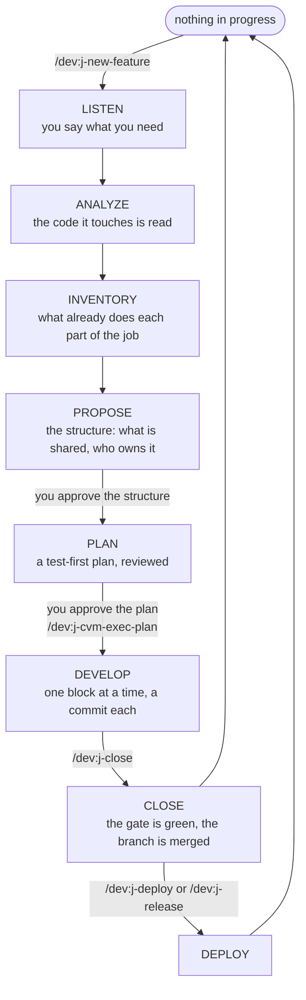
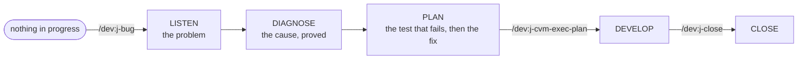
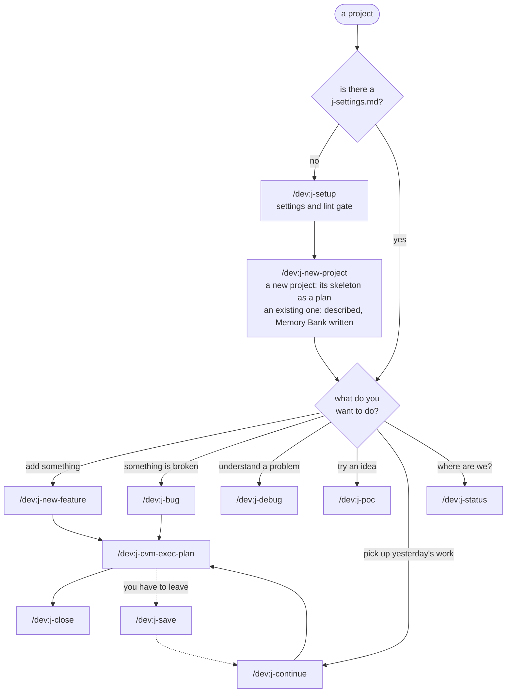
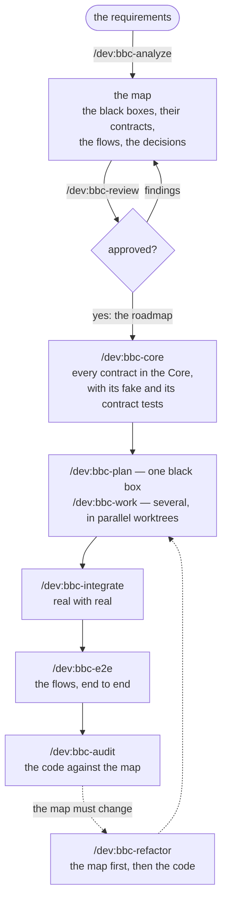

# How the `dev` plugin works

The plugin gives the agent a way of working, not a list of tricks. A piece of work goes through the
same phases every time; each phase leaves something written in the project, so that the next one —
perhaps days later, in another session — starts from what is written and not from what the agent
remembers. You decide at three points: what you need, the structure, the plan. The agent writes no
production code before the third.

Every command is typed with the plugin's name in front: `/dev:j-setup`.

## A feature, from the request to the merge

| Phase | What happens | What it leaves in the project |
|---|---|---|
| LISTEN | You say what you need. The agent reads no code and proposes nothing | `notes.md` — the requirements, in the task's folder |
| ANALYZE | The code the work touches is read, with the rules that apply to it | the analysis, in `notes.md` |
| INVENTORY | For each part of the job, what already does it is searched — by what it does, not by its name | one line per capability: where it lives, and the decision — reuse, extend, write |
| PROPOSE | The structure is decided on what the inventory found, and you approve it | the code organization, in `notes.md` |
| PLAN | A plan of small blocks, each one a failing test first and then the code that makes it pass; reviewed against the rules and the real code, then shown to you | `plan.md` |
| DEVELOP | The plan is executed block by block: red, green, verify, commit | a commit per block |
| CLOSE | The change is read against the rules, the project's gate runs — lint, tests, build — and the branch is merged | the merge |
| DEPLOY | The project's own deploy scripts, by hand or through its pipeline | — |

The plan is executed by the CVM plan executor, an MCP server that hands the agent one block at a time
and keeps the state: a plan interrupted is resumed where it stopped. `/dev:j-mcp-setup` installs it.

## A bug

A bug designs nothing, so it has no inventory and no structure of its own: the cause is found first,
with evidence, and the fix is a plan like any other.

`/dev:j-debug` looks for a cause without opening a branch or a task: it explains and changes nothing.
When what it finds is a bug, `/dev:j-bug` starts from it.

## Which command, when

| Command | What it does |
|---|---|
| `/dev:j-setup` | Finds what the project shows — language, stack, commands — asks only what it cannot see, writes `j-settings.md` and wires the lint gate. Run first, once per project; run again to check and repair |
| `/dev:j-new-project` | A new project: from what it must be to the plan of its skeleton. An existing one: wired, described, given its Memory Bank |
| `/dev:j-new-feature` | A feature, up to a reviewed plan; then it stops |
| `/dev:j-bug` | A bug, up to a reviewed plan of the fix; then it stops |
| `/dev:j-cvm-exec-plan` | Executes a plan, block by block; resumes one that was interrupted |
| `/dev:j-review-plan`, `/dev:j-cvm-check-plan` | A plan reviewed against the rules and the code; its structure checked |
| `/dev:j-close` | Reads the change against the rules, runs the gate, merges, optionally deploys |
| `/dev:j-deploy`, `/dev:j-release`, `/dev:j-ci-setup` | Deploy by hand; release through the pipeline; set the pipeline up |
| `/dev:j-save`, `/dev:j-continue`, `/dev:j-status` | Save and leave; resume; see where the work stands |
| `/dev:j-debug`, `/dev:j-debug-mb` | Find the cause of a problem, step by step, changing nothing (the second uses less context) |
| `/dev:j-poc` | A proof of concept, in a folder of its own, outside the production code |
| `/dev:j-browse`, `/dev:j-e2e-generate`, `/dev:j-e2e` | The running application in the browser: guided by you; the end-to-end checklist written, then run |
| `/dev:j-mcp-setup`, `/dev:j-init-secrets` | The MCP servers the workflow uses; the project's secrets encrypted in git |
| `/dev:j-help` | The list of the commands |

## A large project: black boxes

A project too large for one context window is designed first as black boxes: each one a
responsibility behind a contract, so that it can be built knowing only the contracts of the others.
The design is done on the requirements, with no code read, and approved before anything is built.

Each of these commands writes a plan and stops, like `/dev:j-new-feature`: the plan is executed with
`/dev:j-cvm-exec-plan` and closed with `/dev:j-close`. `/dev:bbc-debug` is `/dev:j-bug` for a failure
that crosses several black boxes.

## The audit of the code

`/dev:x-audit-code` checks an existing codebase against the rules, in one command, to a report. A
tool maps the folders you choose — the modules, their shape, who depends on whom — the agent
describes the architecture from the map, reads the map against the rules to find candidates, and
confirms each one by opening the code where it points. What is confirmed is in the report, with the
place and the reason; what was checked and withdrawn is remembered, and not raised again while the
code has not changed.

## What the agent reads

The commands are short; the rules are in pages the commands load when they apply.

- **Principles** — how a piece of code is organized: one owner for each thing, no copy, the contract
  before the mechanism, errors that are not hidden. In every language.
- **Branches** — the rules of a kind of software: an API, a data layer, a frontend, a game, service
  layers, resilience, security, operations. A project names the ones it has.
- **Language overlays** — how the principles are written in a language and its testing: C, C++, C#,
  Dart, GDScript, Go, Java, Kotlin, Perl, PHP, Python, Rust, Swift, TypeScript, with Angular, React,
  Vue, ASP.NET Core, EF Core and others.
- **Planners** — what a test-first plan is, block by block, and what a plan of steps is, for removals
  and migrations.
- **Debug protocol** — a cause is proved before a fix is proposed.

## What is in your project afterwards

| File | What it is |
|---|---|
| `j-settings.md` | The project's settings: its languages, its commands, its lint gate, its tests by level, its branches, its deploy |
| `memory-bank/` | What the project is and where the work stands: read at the start of a session, updated at the end |
| `tasks/NN-<name>/` | One folder per feature or bug: `notes.md`, `plan.md` |
| the linter's configuration, `.ast-grep/`, `sgconfig.yml` | The lint gate of the project's languages |
| `CLAUDE.md` | The project's instructions for the agent |

## The lint gates

A gate is there for the agent to check itself, not to please a reader: it keeps only the rules that
find a defect — a null that is silenced, an error that is swallowed, a query built by concatenation —
one by one, each for its reason. Style, naming and formatting rules are out, because an agent that
meets a hundred of them on an existing project rewrites the project instead of doing the work.
