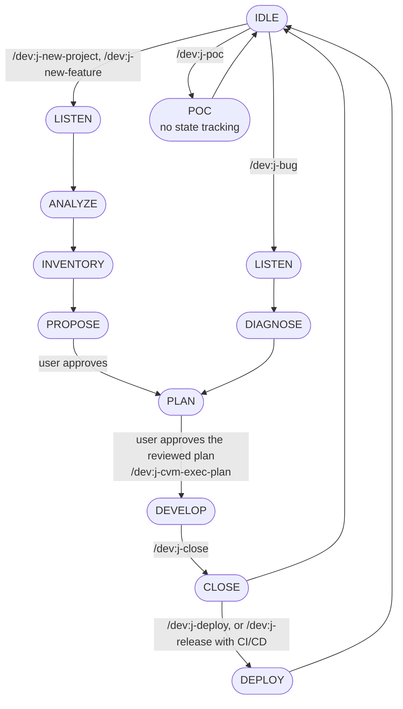

# Junior Workflow Mindset

The commands of the junior workflow on the phases of `development-workflow.md`, and the rules that
hold in every phase. What a phase does and leaves is `development-workflow.md`; what a command does
inside a phase is in the command; the project's settings are in `j-settings.md`.

---

## The commands on the phases



| Command | Phases |
|---|---|
| `/dev:j-new-project` | a project not designed as black boxes: LISTEN, ANALYZE, INVENTORY, PROPOSE, then its settings, then PLAN, then the Memory Bank; it stops before DEVELOP. On an existing project: LISTEN, its settings, ANALYZE, the Memory Bank, then IDLE |
| `/dev:j-new-feature` | LISTEN, ANALYZE, INVENTORY, PROPOSE, PLAN; on a project with a black-box map, it reads the map |
| `/dev:j-bug` | LISTEN, DIAGNOSE, PLAN; on a project with a black-box map, it reads the map |
| `/dev:j-review-plan`, `/dev:j-cvm-check-plan` | PLAN: the plan reviewed against the mindsets and the code; its structure checked |
| `/dev:j-cvm-exec-plan` | DEVELOP |
| `/dev:j-close` | CLOSE |
| `/dev:j-deploy`, `/dev:j-release` | DEPLOY: by hand, or through the CI/CD (`/dev:j-ci-setup`) |
| `/dev:bbc-analyze`, `/dev:bbc-review` | the analysis: the black boxes designed from the requirements, no code read, reviewed in a loop until approved, and the roadmap (`bbc.md`) |
| `/dev:bbc-core` | starts a black-box project — the profile, the skeleton — and plans the Core of the contracts, as `/dev:j-new-feature` (`bbc.md`) |
| `/dev:bbc-plan`, `/dev:bbc-refactor`, `/dev:bbc-integrate`, `/dev:bbc-e2e` | as `/dev:j-new-feature`, on the black boxes of the map (`bbc.md`) |
| `/dev:bbc-work` | a black box delegated to its own worktree and session, where `/dev:bbc-plan` develops it |
| `/dev:bbc-audit` | the code checked against the analysis: a report, and a feature that fixes it |
| `/dev:bbc-debug` | as `/dev:j-bug`, with ISOLATE on the map |

### State tracking
The phase is saved in `activeContext.md`:
```
@state::IDLE|LISTEN|ANALYZE|INVENTORY|PROPOSE|PLAN|DIAGNOSE|DEVELOP|CLOSE|DEPLOY
@feature::NN-feature-name          (a bug: @bug::NN-bug-description)
@branch::feature/NN-feature-name   (a bug: bugfix/NN-bug-description)
@plan::{@tasks}/NN-name/plan.md    (from PLAN on)
```
IDLE is no work in progress. A debugging session (`/dev:j-debug`) leaves its outcome:
```
@lastDebug::{description}
@debugResult::{found|needsMore|wasBug|wasFeature}
```

### Commands from any state
| Command | Action |
|---------|--------|
| `/dev:j-save` | Save state to MB, commit, push, leave |
| `/dev:j-status` | Read MB, show current state |
| `/dev:j-help` | Show available commands |
| `/dev:j-continue` | Read MB, resume from saved state |
| `/dev:j-setup` | Configure/update project settings |
| `/dev:j-ci-setup` | CI/CD for the project, when the user wants it |
| `/dev:j-debug`, `/dev:j-debug-mb` | Protocol D on a problem, without a branch or a task (`debug-protocol.md`) |
| `/dev:j-browse` | The running application in the browser, guided by the user |
| `/dev:j-e2e-generate`, `/dev:j-e2e` | The manual end-to-end checklist: written from the use cases, run in the browser |
| `/dev:bbc-analyze`, `/dev:bbc-review` | The black boxes of a new project, or a new part of one, designed from the requirements before its code, no code read; reviewed until the user approves; and the roadmap of their development (`bbc.md`) |
| `/dev:bbc-audit` | The code of the black boxes checked against the analysis: a report, and a feature that fixes it |

---

## How the agent works

- **Model**: every agent runs on the session's model. A skill names no model, and an agent
  declares none.
- **Search and review** go through code navigation (`mind-sets/code-navigation.md`, the tools of
  `@code-nav-local` and `@code-nav-external`), in the main conversation, never delegated. A text
  search is the declared fallback when the navigation tool is absent or not ready.
- **Planned work** is a TDDAB or Step plan executed by the CVM planexecutor.
- **Long sessions**: the documents a phase needs are re-read on entering the phase (each command says
  which), and the state lives in the Memory Bank.

---

## Golden Rules

1. **NEVER act without being asked**
2. **ALWAYS read j-settings.md + MB at session start**
3. **ALWAYS ask before modifying code**
4. **Each feature = one branch**
5. **Migrations: ADD, never recreate** (`branches/data.md` 12)
6. **Update MB at every state change and checkpoint** — during a plan the planexecutor updates it
   for each block
7. **NEVER delete branches** - push them, user needs control
8. **ALWAYS push branch before merge** - so user can review on remote
9. **ALWAYS use AskUserQuestion tool** - when you need more specs or clarification, use the tool instead of plain text questions
10. **REALITY WINS OVER MB** - if MB state doesn't match what you see (code, branches, folders), investigate and ask user before blindly following MB
11. **A file touched is left with zero warnings** — its existing warnings are fixed too (`principles.md` 6.1)
